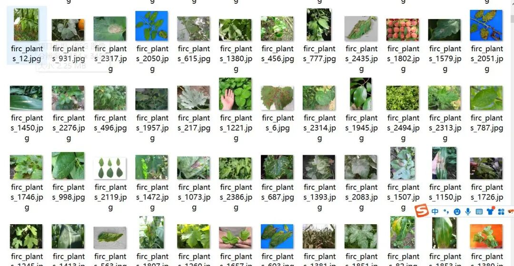
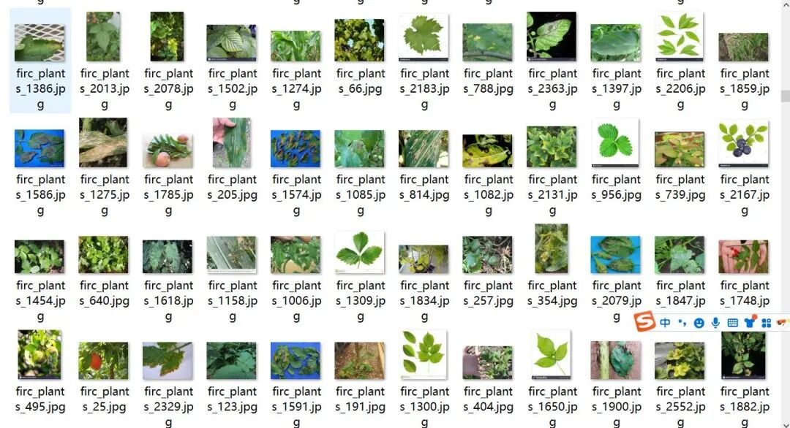
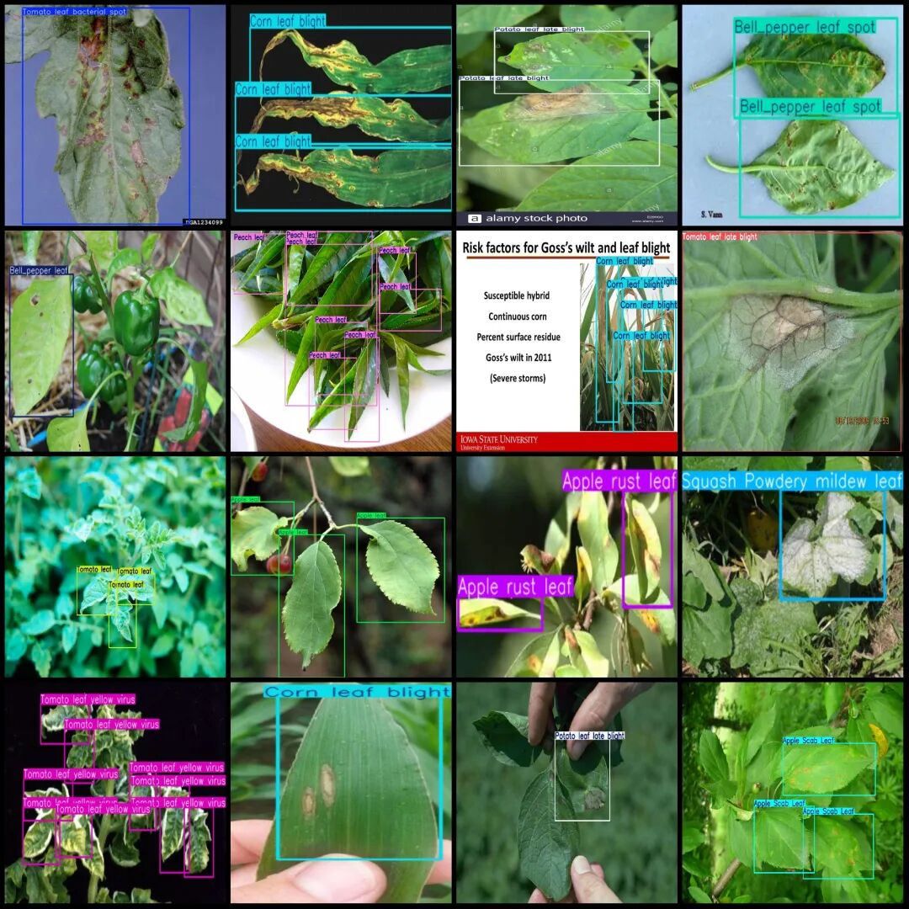
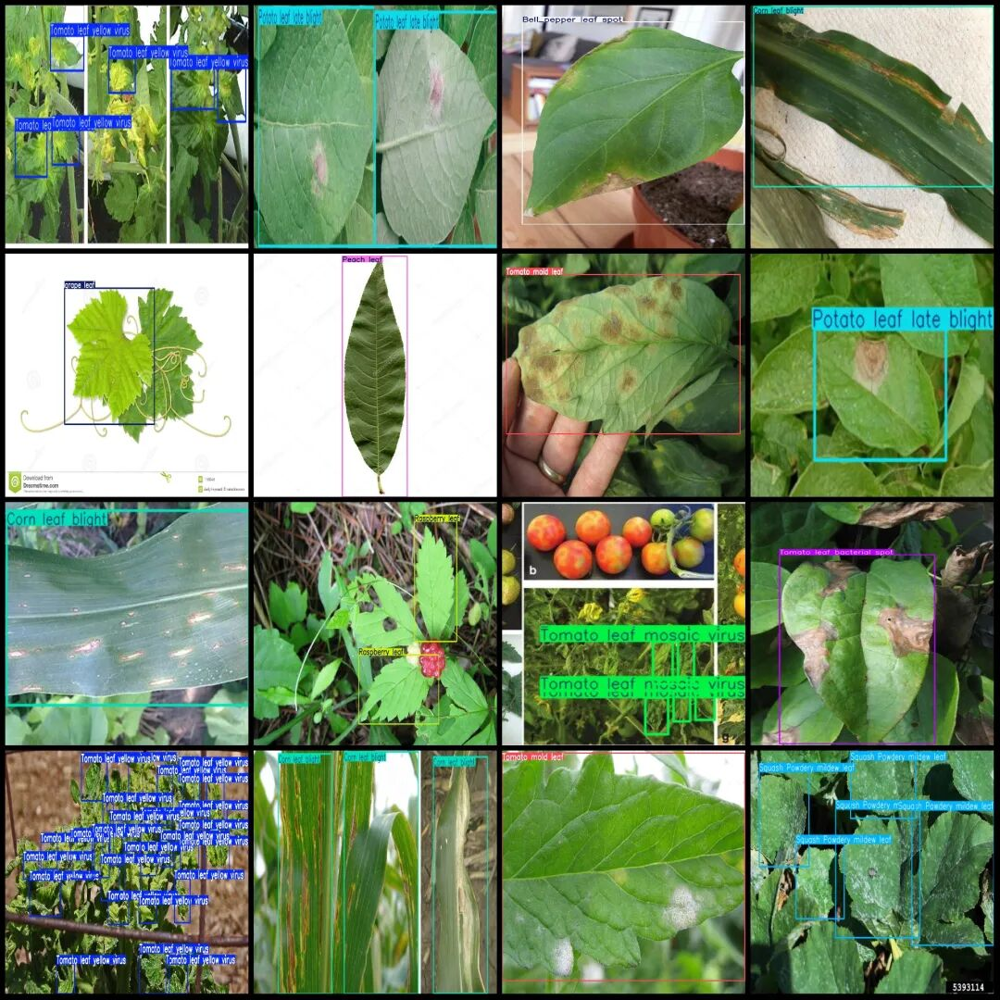

# 13 plant leaf disease detection dataset in VOC+YOLO format with 2258 images and 30 categories

Dataset format: Pascal VOC format + YOLO format (txt file without split path, only contains jpg images and corresponding VOC format xml files and yolo format txt files)

Number of images (number of jpg files): 2558

Number of annotations (number of xml files): 2558

Number of annotations (number of txt files): 2558

Label category count: 30

Label category name(NoteyoloThe format category order does not correspond to this, but instead...labelsFolderclasses.txtPrecision):["Apple Scab Leaf","Apple leaf","Apple rust leaf","Bell_pepper leaf","Bell_pepper leaf spot","Blueberry leaf","Cherry leaf","Corn Gray leaf spot","Corn leaf blight","Corn rust leaf","Peach leaf","Potato leaf","Potato leaf early blight","Potato leaf late blight","Raspberry leaf","Soyabean leaf","Soybean leaf","Squash Powdery mildew leaf","Strawberry leaf","Tomato Early blight leaf","Tomato Septoria leaf spot","Tomato leaf","Tomato leaf bacterial spot","Tomato leaf late blight","Tomato leaf mosaic virus","Tomato leaf yellow virus","Tomato mold leaf","Tomato two spotted spider mites leaf","grape leaf","grape leaf black rot"]

Number of boxes labeled in each category:

Apple Scab Leaf (apple scab leaf) Frames = 171

Apple leaf (apple leaf) Frames = 247

Apple rust leaf (apple rust leaf) frame count = 178

Bell pepper leaf (Sweet pepper leaf) frame count = 323

Bell pepper leaf spot (sweet pepper leaf blight) frame count = 263

Blueberry leaf (Blueberry leaf) Frames = 838

Cherry leaf (Cherry leaf) frame count = 239

Corn Gray leaf spot (corn gray spot) frame count = 76

Corn leaf blight (corn leaf scabbing) frame count = 368

Corn rust leaf (corn rust disease leaf) frame count = 127

Peach leaf (Peach tree leaves) frame count = 614

Potato leaf (potato leaf) frame count = 11

Potato leaf early blight (potato early blight) frame count = 318

Potato leaf late blight (potato late blight leaves) frame count = 245

Raspberry leaf (Raspberry Leaf) Frame Count = 556

Soyabean leaf (Soybean Leaf) Frames = 266

Soybean leaf (Soybean leaf) Frame count = 15

Squash Powdery mildew leaf (Squash powdery mildew leaves) Frame count = 256

Strawberry leaf (Strawberry leaf) Frame count = 492

Tomato Early blight leaf (Tomato Early blight Leaf) Frames = 212

Tomato Septoria leaf spot (Tomato leaf spot) Frame count = 426

Tomato leaf (Tomato leaf) Frame count = 400

Tomato leaf bacterial spot (Tomato bacterial spot) frame count = 280

Tomato leaf late blight (late blight of tomato leaves) frame count = 218

Tomato leaf mosaic virus (Tomato Leaf Mosaic Virus Disease) Frames = 261

Tomato leaf yellow virus (Tomato Yellowing Virus) frame count = 801

Tomato mold leaf (Tomato leaf mold) frame count = 295

Tomato two spotted spider mite leaf (Tomato Two-spotted Spider Mite Leaf) frame count = 2

Grape leaf (Vitis vinifera) frame count = 220

Grape leaf black rot (grape black rot leaves) frame count = 133

Total frame count: 8851

Image resolution: Multi-resolution images, such as 600x668, 640x640, etc.

Using labelImg:

Annotation rules: Draw a rectangle around the category.

Important Notice: No

Special : This dataset does not guarantee the accuracy of the trained models or weight files.

Image Preview:

Annotation example:

## Payment

Here is a pay link on Stripe ( https://buy.stripe.com/3cs8yP7sY87d0vu9AB ). Please contact me lonlonago@foxmail.com after funding $89, and I will send you a complete data files , thank you!

